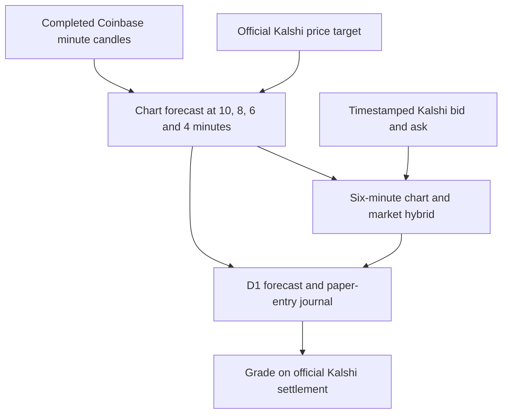

# Bitcoin prediction market research

Can a Bitcoin chart improve on the odds already quoted by a prediction market? This project compares forecasts for Kalshi’s 15-minute BTC contracts, records them before each round closes, and grades them against official settlement. A separate paper ledger measures what each simulated entry would earn at the quoted ask.

## Read the current call

In Cloudflare, open **D1 → kalshi-btc-paper → Studio → Views → round_decisions**. Read the first row. **If the round is Open, the forecast column is the chart’s current direction.** For example, `Down · 72.0% at 6m` means the model favored Down with 72% confidence when six minutes remained. A later checkpoint can change the call.

| Column | What to look for |
| --- | --- |
| `forecast` | Latest valid Up or Down call. “Last valid” means a later checkpoint was unavailable. |
| `round_closes_pt` | Round closing time in Pacific time and whether the round is open, closed awaiting settlement, or settled. |
| `paper_entry` | Direction, checkpoint and price locked for the simulated trade. This can differ from the latest forecast. |
| `official_outcome` | Kalshi’s result and the locked paper trade’s win or loss. Gross P&L is before fees. |

The first checkpoint comes five minutes after a round opens, with ten minutes remaining. If the newest row shows a closed or settled round, the next round has no recorded checkpoint yet. Refresh the view at the next checkpoint.

## Try it in VS Code

Open the repository folder with Node.js 22 or newer installed. Run the first command for an offline demonstration with fictional prices or the second to follow current rounds using the public data feeds.

```sh
node run.mjs --demo
node run.mjs --watch
```

Press **F5** in VS Code to start the continuous watcher. Press **Ctrl+C** in the terminal or **Stop** in the debugger to exit. Use `node run.mjs --once` for a single update. The default display shows the newest valid chart call first. Add `--details` to see earlier checkpoints and available research signals. The local runner needs no API keys. The hosted D1 journal is the record for paper entries and official grades.

## Six-minute results

In a historical walk-forward test, the hybrid model called **24,091 of 29,838 rounds correctly (80.74%)**. The market midpoint called 24,075 correctly and had the lowest probability error. The hybrid's entry rule won **236 of 310** simulated one-contract trades and **lost $6.36 after modeled fees**.

| Forecast at six minutes remaining | Correct / distinct rounds | Brier score ↓ |
| --- | ---: | ---: |
| Chart and market hybrid | 24,091 / 29,838 | 0.135199 |
| Kalshi midpoint | 24,075 / 29,838 | 0.134909 |
| Chart model refit monthly | 24,000 / 29,838 | 0.136624 |

All three forecasts use the same rounds and checkpoint. The hybrid corrected 128 midpoint misses and reversed 112 correct calls. A 95% interval from resampling UTC days puts the accuracy difference between −0.05 and +0.15 percentage points. The hybrid remains a paper challenger. [Monthly and holdout results](backtest/six-minute/hybrid-results.json)

At the November 17 afternoon review, 141 distinct rounds yielded 560 matched checkpoints. The chart called 445 correctly and the retired capped watcher called 440. On the first 15 officially graded six-minute hybrid comparisons the chart got 11 correct, the hybrid 10 and the market midpoint 10. The frozen hybrid continues as a research comparison. [Tracker changes and review queries](docs/replay.md#november-17-tracker-cleanup)

## From prices to a graded forecast



The chart model uses distance to the official target, movement since the round opened and three-minute momentum, scaled by recent volatility. The six-minute hybrid adds the midpoint and spread. The journal keeps the latest chart direction and the original locked paper entry separately, so later forecasts cannot change the price or side used to grade an entry.

## Reproduce the analysis

- **Check the published numbers offline** with `python backtest/check_results.py`. It reconciles the monthly correct counts, probability error and paper economics from the aggregate result files.
- **Repeat the historical fits** with the dated market-data inputs and the commands in the [replay guide](docs/replay.md). The archive covers 31,892 settled rounds through November 16, 2026. Of these, 31,607 had a valid six-minute chart and 31,187 also had usable two-sided prices.
- **Inspect the implementation** in the [shared chart and hybrid models](worker.mjs), [D1 schema](schema.sql) and [prospective six-minute grading query](backtest/six-minute/hybrid_review.sql).

Historical minute-end asks approximate execution. They do not establish the size available or whether an order would have filled. January accounted for 285 of the 310 simulated entries. The prospective journal records fresh observations separately from historical replays.
